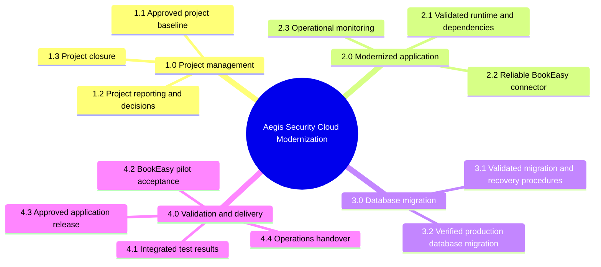

# Work Breakdown Structure

## WBS tree

## Evidence table

| WBS ID | Finished package | Evidence |
|---|---|---|
| 1.1 | Approved project baseline | Charter, requirements, schedule, and responsibilities approved |
| 1.2 | Project reporting and decisions | Status reports and decision log maintained |
| 1.3 | Project closure | Closure record and lessons learned completed |
| 2.1 | Validated runtime and dependencies | Compatibility review and tests pass |
| 2.2 | Reliable BookEasy connector | Retry and duplicate tests pass |
| 2.3 | Operational monitoring | Failure alerts and service-health checks pass |
| 3.1 | Validated migration and recovery procedures | Rehearsal, restore, and reconciliation evidence pass |
| 3.2 | Verified production database migration | Approved migration and post-change checks recorded |
| 4.1 | Integrated test results | Functional, security, and recovery results recorded |
| 4.2 | BookEasy pilot acceptance | BookEasy accepts agreed scenarios |
| 4.3 | Approved application release | Sponsor go/no-go and controlled deployment recorded |
| 4.4 | Operations handover | Runbook and support ownership transferred |

The tree shows how the scope is divided. The table shows how each package is proven complete.
