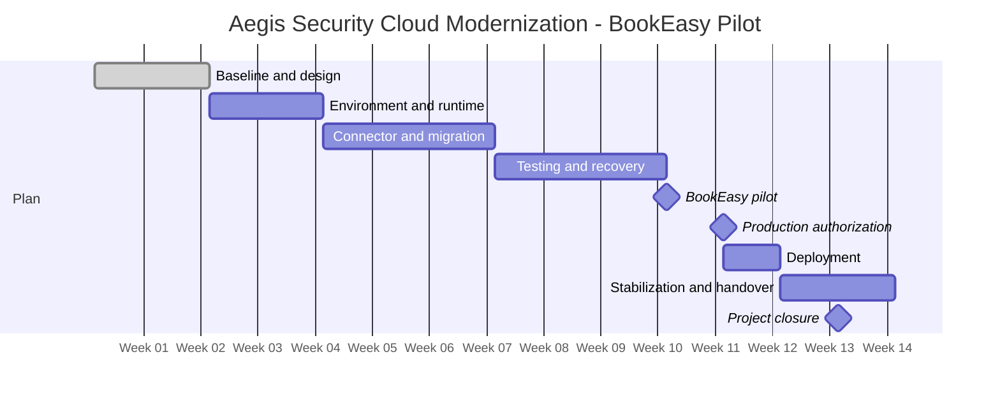

# Project Schedule

## Original schedule baseline

## Gantt view

The Gantt shows calendar duration, dependencies, and milestones across the 12-week plan plus the approved one-week recovery impact.

| Planned work | Start | Finish | Owner | Dependency |
|---|---|---|---|---|
| Planning, design, WBS, and backlog | Week 1 | Week 2 | PM and technical leads | Approved charter |
| Environment, backups, and runtime work | Week 3 | Week 4 | Engineering and DevOps | Target versions proposed |
| Connector, migration rehearsal, and monitoring | Week 5 | Week 7 | Backend, Database, and DevOps | Test environment ready |
| Integration, security, and recovery tests | Week 8 | Week 10 | QA and Security | Requirements ready |
| BookEasy pilot | Week 11 | Week 11 | Customer Success and BookEasy | Tests pass and scenarios agreed |
| Production authorization | Week 12 | Week 12 | CTO / sponsor | Pilot accepted and evidence complete |
| Application and connector deployment | Week 12 | Week 12 | DevOps / SRE | Go decision and change window |
| Stabilization and operations handover | Week 12 | Week 13 | DevOps and Support | Deployment checks pass |
| Project closure | Week 13 | Week 13 | PM | Handover accepted |

## Milestones

| Milestone | Target | Evidence |
|---|---|---|
| Planning approved | End of week 2 | Baseline, owners, and backlog approved |
| Testing completed | End of week 10 | Functional, security, and recovery evidence |
| BookEasy pilot accepted | Week 11 | Customer acceptance record |
| Production authorized | Week 12 | Sponsor go/no-go decision |
| Project closed | Week 13 | Handover and closure record |

## Baseline and dependencies

The schedule baseline is approved by the CTO / sponsor at the end of week 2. Version 1.0 of the schedule becomes the reference for tracking progress and approving changes.

The part-time team availability was reviewed with functional leads when building this estimate. Planning assumptions are: PM 50%, Engineering 50%, Database 25%, DevOps/SRE 25%, Security 15%, QA 50%, Product 10%, Customer Success 20%, and Support 10%. These are planning assumptions, not employment or billing claims. The PM records any competing work that could affect the schedule.

## Critical path

The likely critical path is: target compatibility -> test environment -> migration and recovery rehearsal -> integration and security testing -> BookEasy pilot -> sponsor authorization -> deployment -> stabilization -> operations handover -> closure. Work such as documentation refinement and some stakeholder updates can move within their available float if they do not block these gates.

## Conditions to advance

- Approved test evidence is required before the BookEasy pilot.
- BookEasy acceptance is required before production authorization.
- Stabilization checks must pass before operations handover.
- Handover acceptance is required before project closure.

## Duration versus effort

Calendar duration shows how long a work item occupies the schedule. Effort shows the approximate time a person spends on it. For example, a two-week testing window may require only four QA days because the team is working part time and waiting on evidence from other roles.

## Resource histogram

| Role | Availability per week | W1 | W2 | W3 | W4 | W5 | W6 | W7 | W8 | W9 | W10 | W11 | W12 | W13 |
|---|---:|---:|---:|---:|---:|---:|---:|---:|---:|---:|---:|---:|---:|---:|
| Project Manager | 20 h | 12 | 16 | 10 | 10 | 10 | 10 | 10 | 14 | 14 | 14 | 16 | 12 | 8 |
| Engineering | 20 h | 8 | 16 | 16 | 16 | 12 | 12 | 12 | 16 | 12 | 10 | 6 | 4 | 2 |
| Database | 10 h | 4 | 6 | 6 | 8 | 8 | 6 | 4 | 4 | 2 | 2 | 2 | 2 | 1 |
| DevOps / SRE | 10 h | 4 | 6 | 8 | 8 | 6 | 6 | 6 | 8 | 6 | 6 | 8 | 10 | 6 |
| Security | 6 h | 2 | 2 | 2 | 2 | 2 | 2 | 2 | 6 | 6 | 6 | 2 | 2 | 1 |
| QA | 20 h | 4 | 8 | 4 | 4 | 6 | 8 | 8 | 16 | 16 | 16 | 12 | 8 | 4 |

The histogram uses planning hours, not actual time tracking. No burndown is included because this project is not organized into sprints.

This is the original approved schedule baseline. Any later change must document impact and authorization.

## Key terms

**Schedule baseline:** The approved time plan used to track progress and assess changes.  
**Milestone:** A significant point or completed result in the schedule.  
**Dependency:** Work that must happen before another activity can start or finish.  
**Stabilization:** The period after deployment used to monitor service health, resolve early issues, and confirm handover readiness.
